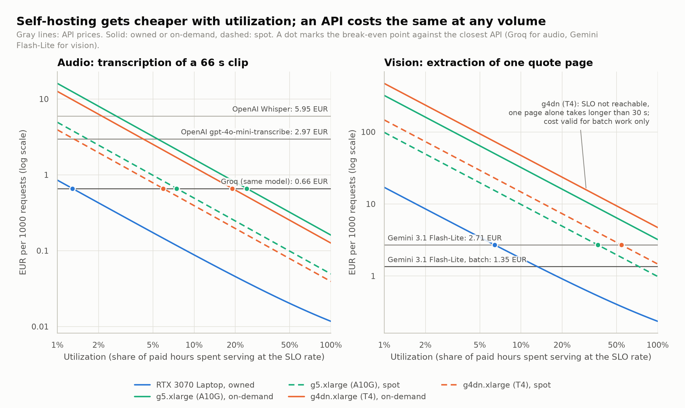
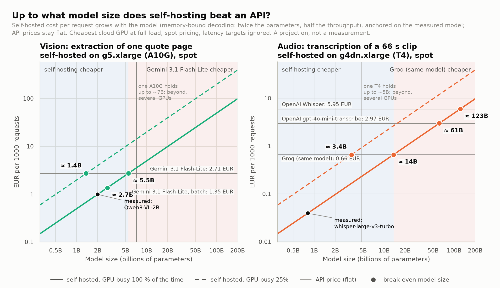
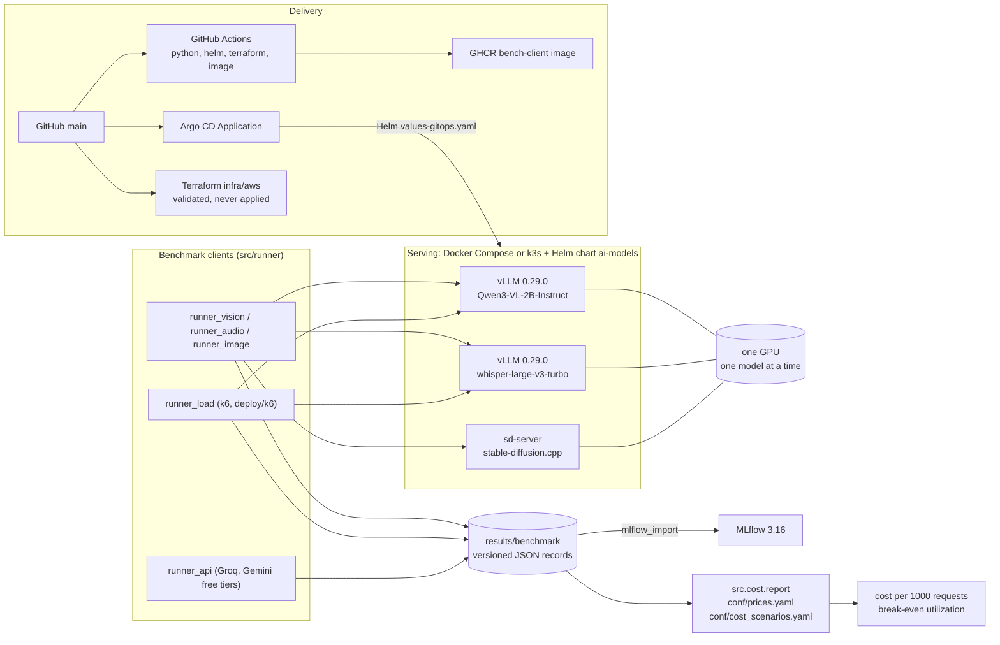

# Cloud × LLM: what does self-hosting an AI model really cost?

APIs charge per request; a GPU charges per hour, busy or not. So at what volume does running a
model yourself become cheaper than paying an API? I wanted a real answer, with measurements rather
than spec sheets, so this project serves three open multimodal models, measures what they actually
deliver, and turns the measurements into a **cost per 1000 requests** to compare with API prices.

Everything here was built on a zero budget: a laptop GPU, a free Kaggle T4, and public AWS prices.



## What I found

- **Transcription is worth self-hosting.** Whisper large-v3-turbo on a `g4dn.xlarge` beats Groq,
  which serves the very same model, above about 19 % utilization on-demand (around 620,000
  transcriptions of 66 s a month) and 6 % on spot (around 190,000). Against OpenAI's transcription
  APIs it wins almost immediately.
- **Document extraction is not, with a small model.** Gemini 3.1 Flash-Lite is cheaper than any
  on-demand GPU at any volume, more accurate (100 % of fields against 96.7 %) and 3.6 times faster (4.8 s against 17.5 s a page).
- **Utilization matters more than the GPU.** An idle instance still costs its full price, so at 10 %
  utilization each request costs ten times more. The break-even volume only depends on the hourly
  price and the API price.
- **A cheaper GPU is not always cheaper.** A T4 delivers 62 % of the laptop GPU's throughput for
  audio but only 33 % for vision, and cannot keep a 30 s latency target for a single page.
- **fp16 on the T4 costs nothing in quality**: same transcripts, word for word, and the same field
  accuracy (96.7 %) as bf16.

And for bigger models? A bigger model needs more GPU time per request, while an API price stays
the same. Starting from the measured models, this projection draws where the two lines cross: about
5.5B parameters for document extraction against Gemini Flash-Lite, about 14B for transcription
against Groq, if the GPU is kept busy. At 25 % utilization those sizes drop fourfold. It is a model,
not a measurement; its rules are in the report.



The full write-up, with all the figures, is in **[docs/report.md](docs/report.md)**.

## The models

| Task | Model | Served by | Measured on |
|---|---|---|---|
| Car repair quote (PDF) → structured JSON | Qwen3-VL-2B-Instruct | vLLM | RTX 3070 Laptop, Tesla T4 |
| Speech → text | whisper-large-v3-turbo | vLLM | RTX 3070 Laptop, Tesla T4 |
| Text → image | Qwen-Image 2.1 Turbo (GGUF) | stable-diffusion.cpp | RTX 3070 Laptop |

The laptop GPU stands in for the A10G of AWS `g5` instances (same architecture), the free Kaggle T4
for the GPU of `g4dn` instances (same chip). The inputs are versioned and shareable: a generated,
fictitious quote with its ground truth, and a 66 s LibriSpeech clip with its transcript.

## How it works



1. **Serve** the models behind HTTP APIs, one at a time on the GPU: with Docker Compose, or on
   Kubernetes (k3s) with a Helm chart that Argo CD can keep in sync with Git.
2. **Measure** with small Python runners: latency, throughput, GPU power and energy, quality (word
   error rate, field accuracy), and the sustained throughput under load with k6. Each run writes one
   JSON record in `results/benchmark/`, the single source of truth (MLflow gets a copy).
3. **Price** with `src/cost`: measured throughput, public prices and explicit assumptions give the
   cost per 1000 requests and the utilization at which self-hosting beats each API.
4. **Plot** with `src/report`: every figure of the report is rebuilt from the records.

The AWS side (a GPU node running k3s, S3, IAM, budget alerts) is written in Terraform, validated and
tested in CI, but never applied.

## Try it

You need Linux or WSL2, an NVIDIA GPU, Docker with the NVIDIA Container Toolkit, Python 3.13 and
[uv](https://docs.astral.sh/uv/). The cost model and the figures run without a GPU, on the
measurements already in the repository:

```bash
python3.13 -m venv venv && source venv/bin/activate
uv pip install -r requirements.txt -r requirements-dev.txt

python -m src.cost.report                 # cost per 1000 requests, from the versioned records
python -m src.report.make_figures         # rebuild the figures in docs/figures/
python -m src.runner.summarize audio --by-env --tag ls66-c8
```

To measure on your own GPU (model weights, Compose, k3s, k6, the Kaggle notebook), follow the
**[usage guide](docs/usage.md)**.

## Repository map

```
src/            runners, HTTP clients, records, cost model, report figures
conf/           prices (with sources), cost assumptions, extraction schema
inputs/         the fictitious quote and the LibriSpeech clip, with their references
results/        benchmark records (JSON), one file per run
deploy/         Helm chart, Argo CD, k6 scripts, k3s and device plugin settings
infra/aws/      Terraform for a GPU node (never applied)
kaggle/         notebook to replay the benchmark on a free Kaggle T4
scripts/        model switching, benchmark series, k3s, Kaggle import
docs/           report, usage guide, decisions, figures
tests/          pytest suite (code, schema sync, figures, scripts)
```

## Documentation

- [docs/report.md](docs/report.md): method, results, figures, limits.
- [docs/usage.md](docs/usage.md): setup and every command (Compose, k3s, Argo CD, benchmarks, k6,
  APIs, Kaggle, Terraform, CI).
- [docs/decisions.md](docs/decisions.md): the choices behind the numbers and what they imply.
- [kaggle/](kaggle/): measuring on a free T4.

## Limits worth knowing

- No AWS instance was measured: GPUs stand in for instances, and the A10G throughput is assumed.
- One input per task, so quality numbers are indicative; real scans and noisy audio would do worse.
- T4 results depend on the vLLM version (slower attention kernels on that architecture).

## License

The code is under the [MIT license](LICENSE). The LibriSpeech clip keeps its own license,
CC BY 4.0 (details in [inputs/audio/README.md](inputs/audio/README.md)); model weights are not
included and keep their authors' licenses.
