# Self-hosting multimodal models or paying an API: a measured cost comparison

This report sums up what the project measured and what it means for the cost of running AI models.
Every number comes from a versioned JSON record in [results/benchmark/](../results/benchmark/), and
every figure is rebuilt from those records by `python -m src.report.make_figures`. How to run
things is in the [usage guide](usage.md); why things are done a certain way is in
[decisions.md](decisions.md).

## Summary

- **Transcription is worth self-hosting at moderate volume.** Whisper large-v3-turbo on a
  `g4dn.xlarge` (T4) beats Groq, which serves the same model, above 19 % utilization on-demand
  (about 620,000 transcriptions of 66 s per month) and 6 % on spot (about 190,000). It beats OpenAI's transcription
  APIs almost immediately.
- **Document extraction is not, with a 2-billion-parameter model.** Gemini 3.1 Flash-Lite is
  cheaper than any on-demand GPU instance at any volume, more accurate (100 % of fields against
  96.7 %) and 3.6 times faster. Only spot instances at high utilization, or a machine one already
  owns, come out cheaper.
- **Utilization decides more than the GPU.** An instance costs the same when it is idle: at 10 %
  utilization every request costs ten times more than at full load. The break-even *volume* only
  depends on the hourly price and the API price; a faster GPU only raises the ceiling.
- **The T4 is a weaker proxy than its price suggests.** On the same inputs it reaches 62 % of the
  RTX 3070 Laptop throughput for audio and 33 % for vision, and the gap widens as the batch grows.
  For vision it cannot meet the 30 s latency target at all: one page alone takes 37.6 s.
- **fp16 costs nothing in quality here.** The T4, which has no bf16, produced word-for-word the same
  transcripts and the same field accuracy as the 3070 in bf16.
- **A projection to other model sizes** (section 3.8): with a busy GPU, self-hosting stays cheaper
  than the API up to about 5.5B parameters for extraction and 14B for transcription; a 24/7
  instance needs about 100,000 pages a month before it can beat the API at all.

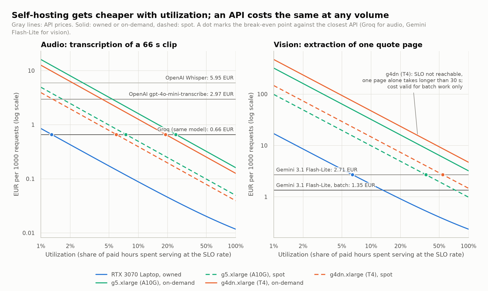

## 1. Question and scope

From what usage volume is it cheaper to host a model yourself (a local GPU, or an on-demand or
spot cloud VM) than to pay an API per request?

Three open models cover three load profiles, closer to a real catalog of services than a single
chat model:

| Task | Model | Server | Unit of work |
|---|---|---|---|
| Vision: PDF page → structured JSON | Qwen3-VL-2B-Instruct | vLLM 0.29.0 | one page of a car repair quote |
| Audio: speech → text | whisper-large-v3-turbo | vLLM 0.29.0 | one 66 s clip |
| Image: text → image | Qwen-Image 2.1 Turbo (GGUF) | stable-diffusion.cpp | one 768×768 image |

The cost comparison covers vision and audio, the two tasks with a hosted API that serves a
comparable model. Image generation is measured for throughput and cold start only.

The budget was zero: no AWS instance was ever launched. Two free GPUs stand in for cloud GPUs, and
public AWS prices are applied to what they measure.

| Measurement GPU | Architecture | Stands in for | Limit of the proxy |
|---|---|---|---|
| RTX 3070 Laptop, 8 GB (local, WSL2) | Ampere, SM 8.6 | A10G of `g5.xlarge` | 8 GB of VRAM instead of 24 GB; a laptop power and cooling budget |
| Tesla T4, 16 GB (Kaggle, free) | Turing, SM 7.5 | T4 of `g4dn.xlarge` | same GPU, but different CPU, disk and network |

## 2. How it was measured

**Serving.** The models run behind HTTP APIs, one at a time on the GPU, with Docker Compose and
then on k3s with a Helm chart, optionally reconciled from Git by Argo CD. The results below come from Docker Compose unless
stated; Compose and k3s are labeled as separate environments and never mixed.

**Records.** Every run writes one JSON record: the conditions (tag, concurrency, environment
label), latencies, throughput, GPU samples from `nvidia-smi` (utilization, power, energy, VRAM),
vLLM scheduler samples from `/metrics`, and quality when a reference exists. Failed runs are
recorded too. A warmup run follows every start and is excluded; every condition has at least
three runs. MLflow receives a copy of each record, but the records are the source of truth.

**Inputs.** Only versioned, shareable inputs are used:

- a **fictitious car repair quote**, generated by code (same bytes every time), with its ground
  truth: 92 fields to extract into a strict JSON schema, 3,106 input and 1,296 output tokens;
- a **66 s LibriSpeech clip** (CC BY 4.0, ten consecutive utterances, 148 words) with its reference
  transcript, for the word error rate (WER).

**Sustained throughput.** A model's cost depends on what it can serve while meeting a latency
target, not on how fast one isolated request goes. k6 sends requests at a constant arrival rate,
in steps, three runs per step. The sustained rate is the highest step at which every run kept its
p95 latency under the SLO, with no failure and no dropped request. The SLOs are choices: p95 under
5 s for a 66 s transcription, under 30 s for a quote page.

**Cost model.** For a self-hosted option:

```
cost per request = hourly cost / (sustained requests per hour × utilization) + per-request costs
```

The hourly cost of an instance includes its 100 GB gp3 root volume and a small S3 bucket; the
per-request costs are internet egress for the answer and, on the laptop, electricity (GPU energy
× 1.5 for the rest of the machine). The laptop's hourly cost amortizes 1,400 EUR over three years
plus 40 W of idle power. Spot instances add the time lost restarting after interruptions (the
measured cold start). Utilization is the share of paid hours actually spent serving at the
sustained rate.

API prices come from the providers' public price pages; the vision API is priced with the tokens
Gemini actually billed for the page. AWS prices are on-demand and spot prices in Paris
(`eu-west-3`), converted at 1 EUR = 1.1165 USD. Prices live in
[conf/prices.yaml](../conf/prices.yaml) with their source and date, every assumption in
[conf/cost_scenarios.yaml](../conf/cost_scenarios.yaml).

**From proxy GPU to instance.** The sustained rate is measured on the 3070. A `g4dn.xlarge` gets that
rate multiplied by the measured T4/3070 throughput ratio at saturation; a `g5.xlarge` gets it
unchanged (the A10G is at least as fast as the 3070 Laptop, a conservative assumption that was not
measured).

Every term, its source and worked examples are in [section 6](#6-how-the-cost-is-computed-step-by-step).

## 3. Results

### 3.1 Cost per 1000 requests

The figure at the top of this report draws the cost of each option against utilization. Self-hosted
costs fall as 1/utilization; API prices are flat. Where a curve crosses an API line, self-hosting
becomes cheaper.

**Audio** (66 s clip; sustained 2.0 requests/s on the 3070):

| Option | Requests/h | EUR/h | EUR/1000 at 100 % | at 10 % | Cheaper than Groq above | 24/7 EUR/month |
|---|---|---|---|---|---|---|
| RTX 3070 Laptop, owned | 7,200 | 0.061 | 0.012 | 0.088 | 1 % | 45 |
| `g4dn.xlarge` (T4), spot | 4,466 | 0.175 | 0.039 | 0.39 | 6 % | 128 |
| `g5.xlarge` (A10G), spot | 7,200 | 0.355 | 0.049 | 0.49 | 7 % | 259 |
| `g4dn.xlarge` (T4), on-demand | 4,466 | 0.562 | 0.126 | 1.26 | 19 % | 410 |
| `g5.xlarge` (A10G), on-demand | 7,200 | 1.16 | 0.161 | 1.60 | 24 % | 843 |
| Groq, same model | | | **0.66** | 0.66 | | |
| OpenAI gpt-4o-mini-transcribe | | | **2.97** | 2.97 | | |
| OpenAI Whisper | | | **5.95** | 5.95 | | |

**Vision** (one quote page; sustained 0.1 page/s on the 3070):

| Option | Pages/h | EUR/h | EUR/1000 at 100 % | at 10 % | Cheaper than Gemini above | 24/7 EUR/month |
|---|---|---|---|---|---|---|
| RTX 3070 Laptop, owned | 360 | 0.061 | 0.24 | 1.76 | 6 % | 45 |
| `g5.xlarge` (A10G), spot | 360 | 0.355 | 0.99 | 9.85 | 36 % | 259 |
| `g4dn.xlarge` (T4), spot ¹ | 119 | 0.175 | 1.47 | 14.7 | 54 % | 128 |
| `g5.xlarge` (A10G), on-demand | 360 | 1.16 | 3.21 | 32 | never | 843 |
| `g4dn.xlarge` (T4), on-demand ¹ | 119 | 0.562 | 4.71 | 47 | never | 410 |
| Gemini 3.1 Flash-Lite | | | **2.71** | 2.71 | | |
| Gemini 3.1 Flash-Lite, batch | | | **1.35** | 1.35 | | |

¹ The SLO cannot be met on a T4: one page alone takes 37.6 s for a 30 s target. The cost holds for
batch work without a latency target.

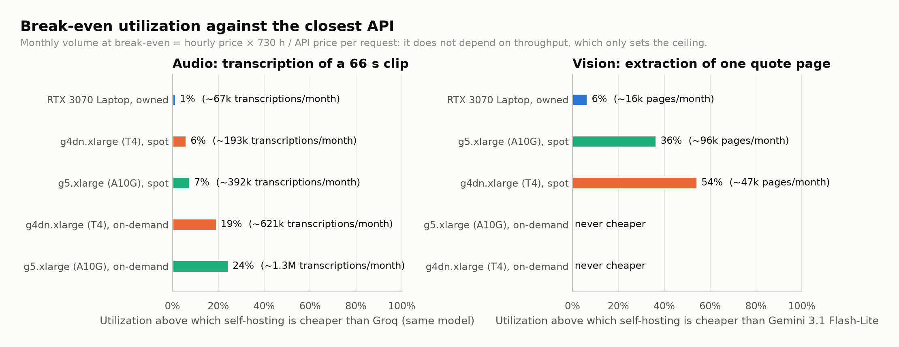

Three things stand out:

- **Spot changes the answer.** The same `g4dn.xlarge` costs 0.18 USD/h on spot against 0.615 USD/h
  on-demand in Paris, with interruptions under 5 % per month. A one-to-two-minute restart after an
  interruption is negligible next to that.
- **The break-even volume is set by prices, not by the GPU.** Hourly price × 730 hours / API price
  per request gives the monthly volume above which a 24/7 instance pays off: about 620,000
  transcriptions for an on-demand `g4dn.xlarge`, whatever its throughput. Throughput only decides
  whether the instance *can* serve that volume, and at which utilization it does.
- **A slow GPU can be the expensive one.** For vision, the T4 instance is half the price of the A10G
  one but serves a third of the pages, so it costs 1.5 times more per page.

### 3.2 Throughput and saturation

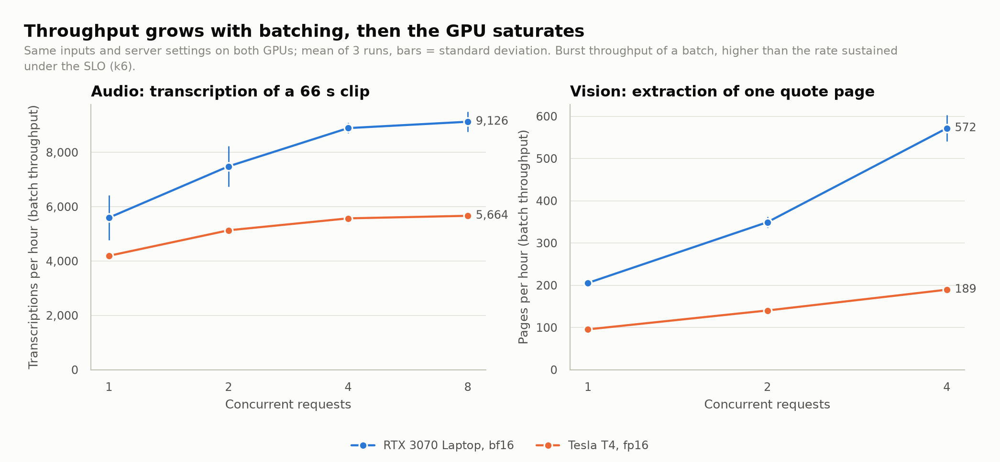

Sending requests concurrently lets vLLM batch them, and throughput grows until the GPU saturates.
For vision, decoding dominates (1,296 generated tokens per page): four concurrent pages bring 2.8
times the throughput of one, for 44 % more latency per page.

For audio on the 3070, throughput stops growing beyond four concurrent requests. A 66 s file is
three 30 s chunks, so four requests are already twelve sequences for a scheduler limit of eight.
The KV cache stays under 10 %, so memory is not the limit. Two extra series settle the question:
doubling `--max-num-seqs` to 16, or raising `--max-num-batched-tokens` to 8,192 (the encoder
budget), does not change the throughput. The 3070 is compute-bound at that point, at 80-90 %
utilization and about 83 W.

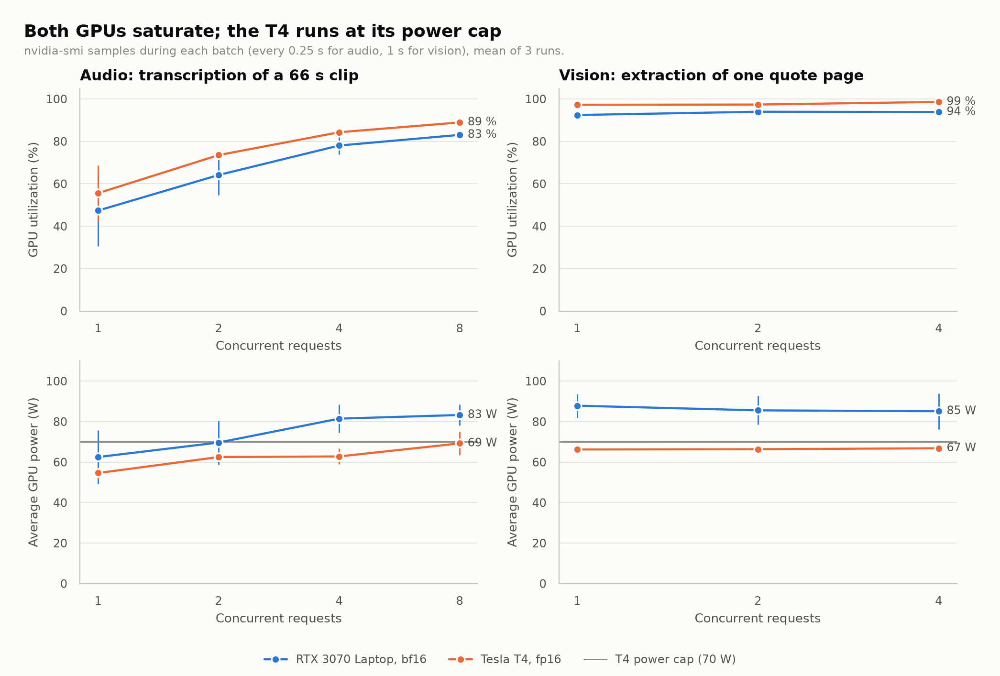

The T4 runs at its 70 W power cap in every vision run, at 97-99 % utilization, with very stable
repetitions (189.4 to 189.5 pages/h at four concurrent pages). The laptop, by contrast, loses
throughput as it heats up: 603 then 541 pages/h over three repetitions of the same condition.

### 3.3 The T4 against the RTX 3070 Laptop

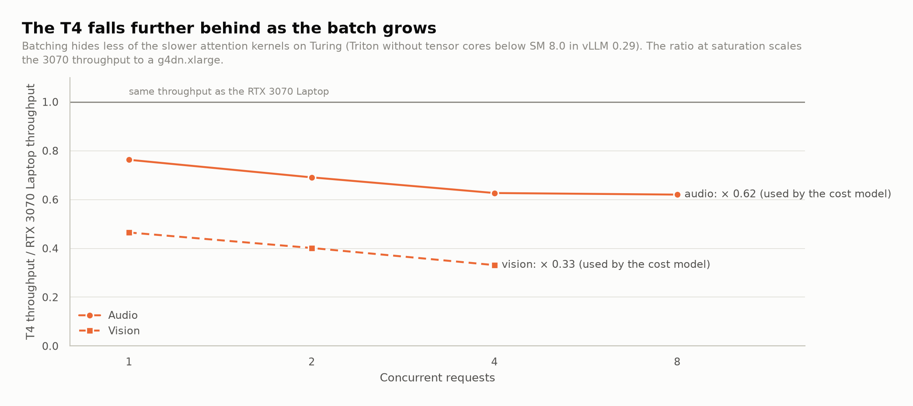

| | 3070, bf16 | T4, fp16 | T4 / 3070 |
|---|---|---|---|
| Vision latency per page, one request | 17.5 s | 37.6 s | |
| Vision throughput, 4 concurrent pages | 572 pages/h | 190 pages/h | **0.33** |
| Audio `batch_rtf`, 8 concurrent requests | 0.0059 | 0.0096 | **0.62** |
| Audio latency, one request | 0.65 s | 0.86 s | |

The T4 falls further behind as the batch grows (audio: 0.77 with one request, 0.62 with eight;
vision: 0.47 then 0.33). On Turing, vLLM 0.29 can only use Triton attention, which does not use the
tensor cores below SM 8.0; batching hides less of that. These T4 figures are tied to the vLLM
version and would be worth measuring again if faster kernels come back to this architecture.

The cost model uses the ratio at saturation, the regime in which a busy instance works; a ratio
taken with a single request would flatter the T4.

### 3.4 Sustained throughput under load

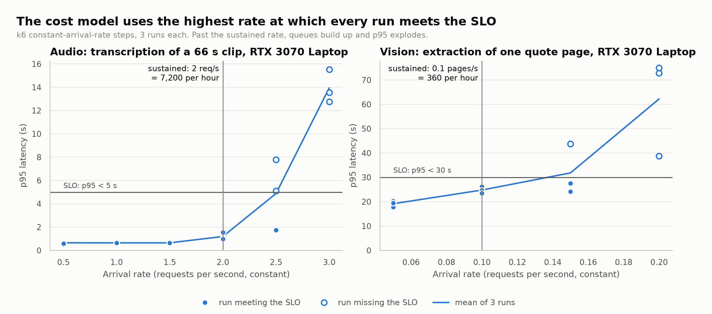

On the 3070, audio holds the SLO up to 2.0 requests/s (7,200 transcriptions per hour, about 130
hours of audio per GPU hour), with a p95 of 1.2 s. At 2.5 requests/s only one run in three keeps it,
and at 3 requests/s queues build up and the p95 reaches 13 to 16 s. The raw capacity, about 2.4 requests/s,
matches the batch throughput measured above.

Vision holds its 30 s SLO up to 0.1 page/s (360 pages per hour, p95 of 24.8 s); the raw capacity,
about 0.14 page/s, is capped by `--max-num-seqs 4` with the GPU at 98 %.

### 3.5 Energy

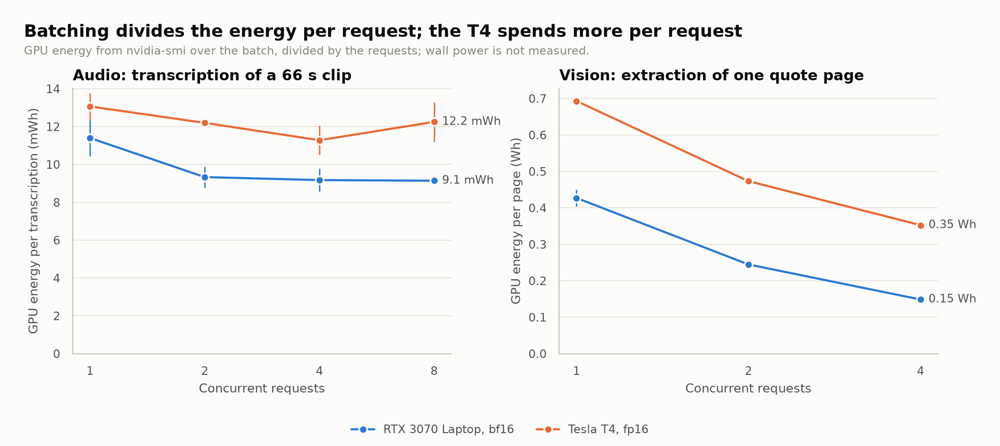

Batching divides the energy per request, since an idle part of the GPU still draws power. At
saturation a transcription costs 9.1 mWh on the 3070 and 12.2 mWh on the T4; a page costs 0.15 Wh
against 0.35 Wh. Under the k6 load, energy per request is higher at low rates (29 mWh per
transcription at 0.5 requests/s against 11 mWh at 2 requests/s) because the idle GPU is charged to
fewer requests. Electricity is a small part of the laptop's cost (French regulated tariff); for a
cloud instance it is included in the hourly price.

### 3.6 Quality

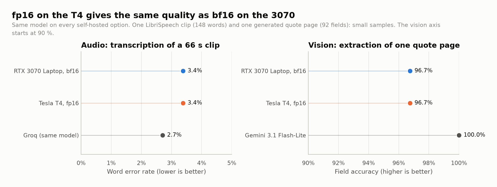

- **Transcription**: WER of 3.38 % (5 errors in 148 words), the same on all 45 runs on the 3070 and
  on all 13 runs on the T4, whatever the concurrency. Groq, serving the same model, makes 4 errors
  (2.70 %): it avoids a word doubled at a 30 s chunk boundary, which comes from the serving stack's
  long-audio chunking, not from the model.
- **Extraction**: 96.7 % of the 92 fields right with one request, 95.7 % in batches on the 3070
  (numerical non-determinism of batching) and 96.7 % at every concurrency on the T4. The errors are
  stable: a misread city, a missing zero in a company number, a wrong enum value. Gemini 3.1
  Flash-Lite gets every field right.
- **fp16 on the T4**: the 46 T4 transcripts are word-for-word the 3070 one, and the field accuracy is
  the same (96.7 % with one request, and no drop in batches). On these inputs, the missing bf16 support has no cost in quality.

### 3.7 Cold start and image generation

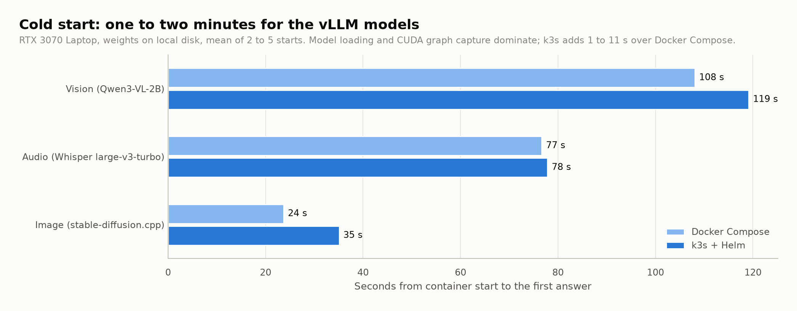

A vLLM model needs one to two minutes from container start to its first answer, mostly loading
weights and capturing CUDA graphs; k3s adds 1 to 11 s over Compose. That is negligible for an
always-on instance or for a spot restart, but it rules out starting a model per request.

Image generation on the 3070 takes about 14 s per 768×768 image in 8 steps (about 250 images per
hour, 0.3 Wh per image). Its speed depends on the free RAM, since the quantized weights are
memory-mapped: with less than about 9-10 GiB free, it slows down.

### 3.8 Projection to other model sizes

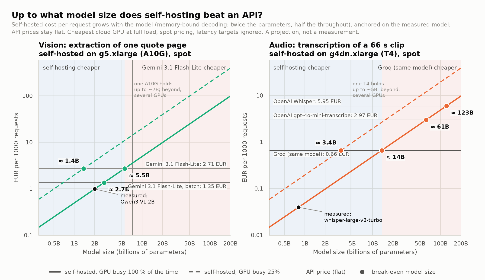

The measurements cover one model per task. The simplest way to extend them: decoding is
memory-bound, so a model twice as large needs about twice the GPU time per request, and the
self-hosted cost per request grows in proportion to the model size, while an API price is flat.
Anchored on the measured models (cheapest cloud GPU, spot, kept busy), the two lines cross at
about **5.5B parameters** for document extraction against Gemini Flash-Lite (2.7B against its batch
tier) and about **14B** for transcription against Groq (61B and 123B against OpenAI). A GPU busy
25 % of the time divides those sizes by four. Above about 7B (A10G) or 5B (T4) the weights no longer
fit on one GPU; the line assumes several GPUs keep the same cost per parameter. This view ignores
latency targets and the fact that a larger model is usually more accurate.

A finer projection adds the monthly volume and the latency target, with these rules
(`src/report/projection.py`):

- decoding is memory-bound, so throughput scales as 1 / model size and latency as model size;
- the 16-bit weights must fit in 60 % of the GPU memory (the rest for the KV cache and
  activations): up to about 4.8B parameters on a T4, 7.2B on an A10G;
- a configuration is interactive only if its p95 at the sustained rate, scaled the same way, stays
  under 30 s;
- one instance runs 24/7, and a volume beyond its capacity pays the extra instance-hours.

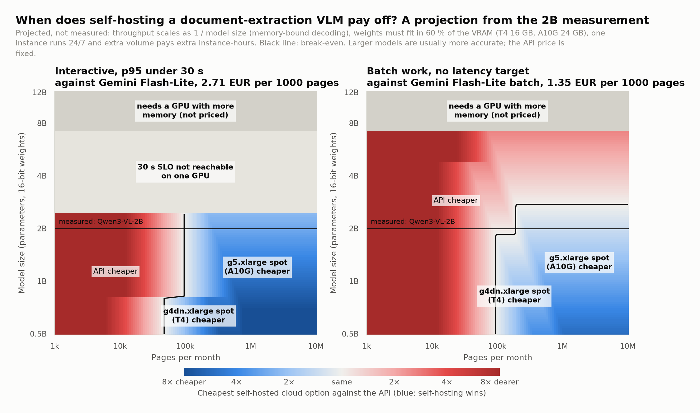

At the measured size, the projection gives back the cost model's numbers exactly (tests check it).
What it shows:

- **Volume first.** Below about 100,000 pages a month, a 24/7 instance cannot beat the API
  whatever the model size: its fixed cost is spread over too few pages.
- **Interactive use caps the model size.** With a 30 s latency target, one A10G handles models up
  to about 2.4B parameters at the measured load; above that, the target needs a faster or second
  GPU. The T4 only fits under 1B.
- **Batch work moves the line, not the conclusion.** Without a latency target, larger models fit,
  but the batch API is half price, so self-hosting only wins below about 2.7B parameters, at high
  volume.

The projection ignores what usually justifies a larger model, better accuracy, and quantization,
which would let larger models fit on the same GPUs. Both would be worth measuring.

## 4. What it means

- **Self-host when the volume is steady and the model is a commodity.** Transcription fits: the
  same open model is available as an API, quality is identical, and a spot T4 pays off from a few
  percent of utilization.
- **Use an API when quality or latency matters more than unit price.** For extraction, a small
  self-hosted model is both less accurate and slower than a cheap hosted one; a larger model would
  need a larger, more expensive GPU.
- **Spot is the default for anything that tolerates a restart.** It divides the hourly price by
  three, and the restart costs one to two minutes.
- **Measure under load, at a latency target.** The throughput of an isolated request, or the burst
  throughput of a batch, would overstate what an instance can sell, and the T4 vision case shows
  that a cheap GPU may not meet the target at all.

## 5. Limitations

- **Proxies, not instances.** No AWS instance was measured. The T4 reproduces the GPU of a
  `g4dn.xlarge` but not its CPU, disk or network; the 3070 Laptop reproduces the architecture of an
  A10G but not its memory or power budget. No proxy exists for `g6` (L4) instances.
- **One input per task.** One clean read-speech clip and one generated quote page. Conversational
  or noisy audio would give a higher WER, a real scanned document a lower accuracy.
- **Small samples.** Three runs per condition; the laptop's heating adds variance under sustained
  load.
- **Version-dependent T4 results.** vLLM 0.29 on Turing uses slower attention kernels.
- **Assumed parts of the cost.** The A10G throughput, the laptop's price, lifetime and wall power,
  and the spot interruption rate for `g5` are assumptions. Labor, availability (redundancy,
  on-call), savings plans and the free egress tier are not counted.
- **Prices move.** Spot prices change constantly; the numbers above use one snapshot.

## 6. How the cost is computed, step by step

This section follows one request through the cost model, with the values used in this report.
Every number below is recomputed by `python -m src.cost.report`; nothing is typed by hand.

### 6.1 The formula

A self-hosted machine is paid by the hour, whether it serves or waits. The cost of one request
is therefore its share of the hourly bill, plus what that request alone consumes:

```
cost per request = H / (R × u) + v
```

| Term | Meaning | Where it comes from |
|---|---|---|
| H | hourly cost of the machine, paid 24/7 (EUR/h) | prices and assumptions (6.3) |
| R | requests per hour the machine sustains while meeting the latency target | k6 measurements (6.2) |
| u | utilization: share of the paid hours spent serving at that rate | a scenario, 100 %, 50 % or 10 % |
| v | cost that grows with each request: electricity on the laptop, egress in the cloud | measurements and prices (6.4) |

The cost is reported per 1000 requests. An API has no H: its price per request is the whole cost.

### 6.2 Sustained throughput (R)

R is not the speed of one request, nor the burst throughput of a batch. k6 sends requests at a
constant rate, in steps, three runs per step; R is the highest step at which **every** run kept
its p95 latency under the SLO, with no failed request and no dropped iteration.

| Workload | SLO (p95) | Retained step | p95 at that step | R on the 3070 |
|---|---|---|---|---|
| Audio, 66 s clip | 5 s | 2.0 requests/s | 1.19 s | 7,200 requests/h |
| Vision, one quote page | 30 s | 0.1 page/s | 24.8 s | 360 pages/h |

The 3070 is the reference. Each cloud instance gets R multiplied by a scale factor:

- `g4dn.xlarge` (T4): the T4/3070 ratio measured at saturation on the same inputs, **0.62** for
  audio (`batch_rtf` with 8 concurrent requests: 0.0059 / 0.0096) and **0.33** for vision (pages per
  hour with 4 concurrent pages: 190 / 572). That gives 4,466 transcriptions and 119 pages per hour.
- `g5.xlarge` (A10G): **1.0**, an assumption. The A10G is at least as fast as the laptop GPU (same
  architecture, more memory bandwidth and power), so 1.0 is on the safe side; it was not measured.

A scale factor assumes the SLO margin carries over to the slower GPU. Where the GPU was measured, the
model checks it with the latency of one request alone: 0.86 s for audio on the T4 (fine against
5 s), 37.6 s for a page on the T4 (above 30 s). The vision cost on `g4dn` is therefore flagged
"SLO not reachable": it holds only for batch work.

### 6.3 Hourly cost (H)

**The RTX 3070 Laptop** is a machine already bought, so its hourly cost is its price spread over
its useful life (straight-line amortization), plus the electricity it draws while idle, since it
stays on to serve:

```
H = hardware price / (lifetime in years × 8,760 h) + idle wall power × electricity price
  = 1,400 EUR / (3 × 8,760 h)                     + 0.040 kW × 0.194 EUR/kWh
  = 0.0533 EUR/h                                   + 0.0078 EUR/h
  = 0.0610 EUR/h, or 44.55 EUR per month (730 h)
```

- 1,400 EUR, 3 years and 40 W are **assumptions**, not measurements: a purchase price for such a
  laptop, a usual service life, and the wall power of the machine on, screen off. Section 6.7 shows
  how much they matter.
- 0.194 EUR/kWh is the variable part of the French regulated tariff (EDF Tarif Bleu, Base option,
  6 kVA, taxes included).
- The idle power is also part of the measured energy per request (6.4): a small double count, on
  the expensive side.
- The whole laptop is charged to the model, as if it did nothing else. A machine that is also used
  for other work would justify charging only a share of it.

**A cloud instance** costs its hourly price plus its storage, converted to euros:

```
H = (instance price + (100 GB gp3 × 0.0928 + 1 GB S3 × 0.024) USD per month / 730 h) / 1.1165
```

For a `g4dn.xlarge` on spot: (0.1827 + 9.304 / 730) / 1.1165 = (0.1827 + 0.0127) / 1.1165 =
**0.1751 EUR/h**. The same instance on-demand: (0.615 + 0.0127) / 1.1165 = 0.5622 EUR/h.

| Instance (Paris) | On-demand, USD/h | Spot, USD/h | H on-demand, EUR/h | H spot, EUR/h |
|---|---|---|---|---|
| `g4dn.xlarge` (T4 16 GB) | 0.615 | 0.1827 | 0.562 | 0.175 |
| `g5.xlarge` (A10G 24 GB) | 1.277 | 0.3833 | 1.155 | 0.355 |

The 100 GB root volume is the Terraform default; the 1 GB bucket holds the records. On spot, the
model adds the serving time lost to interruptions: interruptions per hour (5 % of instances per
month for `g4dn.xlarge` in Paris, from the Spot Instance Advisor) × the measured cold start (78 s
for audio, 119 s for vision). That is about 0.0002 % of the time, negligible; for `g5.xlarge` the
advisor publishes no rate and nothing is added.

### 6.4 Cost per request (v)

- **Electricity, laptop only.** The GPU energy per request is measured under load: the GPU energy of
  the whole k6 step divided by the requests served, idle moments included. `nvidia-smi` only sees the
  GPU, so the rest of the machine (CPU, memory, power supply losses) is added with a factor of 1.5,
  an assumption:

  ```
  audio:  0.01116 Wh × 1.5 × 0.194 EUR/kWh = 0.0000032 EUR per request (0.0032 EUR per 1000)
  vision: 0.22569 Wh × 1.5 × 0.194 EUR/kWh = 0.0000657 EUR per request (0.066 EUR per 1000)
  ```

  In the cloud, electricity is part of the hourly price.
- **Egress, cloud only.** The answer leaves AWS: about 2 KB for a transcript, 4 KB for an
  extraction, at 0.09 USD per GB. That is 0.00016 and 0.00032 EUR per 1000 requests. The input
  (audio, PDF) enters AWS for free.

### 6.5 Putting it together

At 100 % utilization:

| Option | H (EUR/h) | R (per hour) | H / R per 1000 | v per 1000 | **EUR per 1000** |
|---|---|---|---|---|---|
| Audio, RTX 3070 Laptop | 0.0610 | 7,200 | 0.0085 | 0.0032 | **0.0117** |
| Audio, `g4dn.xlarge` spot | 0.1751 | 4,466 | 0.0392 | 0.0002 | **0.0394** |
| Audio, `g4dn.xlarge` on-demand | 0.5622 | 4,466 | 0.1259 | 0.0002 | **0.1261** |
| Vision, RTX 3070 Laptop | 0.0610 | 360 | 0.1695 | 0.0657 | **0.2352** |
| Vision, `g5.xlarge` spot | 0.3547 | 360 | 0.9853 | 0.0003 | **0.9857** |
| Vision, `g5.xlarge` on-demand | 1.1552 | 360 | 3.2088 | 0.0003 | **3.2091** |

At utilization u, only the first part grows: at 10 %, the laptop costs 0.0848 + 0.0032 = 0.088 EUR
per 1000 transcriptions, the `g5.xlarge` spot 9.85 EUR per 1000 pages.

**API prices** come from their public pages and the same inputs:

```
Groq, whisper-large-v3-turbo: 66.42 s / 3,600 × 0.04 USD per hour of audio   = 0.000738 USD → 0.661 EUR per 1000
OpenAI gpt-4o-mini-transcribe: 66.42 s / 60 × 0.003 USD per minute          = 0.003321 USD → 2.97 EUR per 1000
OpenAI Whisper:               66.42 s / 60 × 0.006 USD per minute            = 0.006642 USD → 5.95 EUR per 1000
Gemini 3.1 Flash-Lite: (3,235 input × 0.25 + 1,475 output × 1.50) / 1e6 USD  = 0.003021 USD → 2.71 EUR per 1000
Gemini 3.1 Flash-Lite, batch tier: half the token prices                      → 1.35 EUR per 1000
```

The Gemini tokens are the ones Gemini billed for the page, slightly more than vLLM counts for the
same page with Qwen3-VL (3,106 and 1,296). Groq bills at least 10 s per request, which a 66 s clip
exceeds.

### 6.6 Break-even

Self-hosting is cheaper than an API priced P per request when H / (R × u) + v < P, that is above
the utilization

```
u* = H / (R × (P − v))
```

and the corresponding monthly volume is u* × R × 730 h = H × 730 / (P − v). Throughput cancels out
of the volume: a faster GPU does not lower the volume at which it pays off, it only raises the
ceiling of what it can serve. Two examples:

```
g4dn.xlarge on-demand vs Groq:   u* = 0.5622 / (4,466 × (0.000661 − 0.0000002)) = 19 %  → ~621,000 transcriptions per month
RTX 3070 Laptop vs Gemini:       u* = 0.0610 / (360 × (0.002706 − 0.0000657))   = 6.4 % → ~16,900 pages per month
```

When P − v is negative, or u* would exceed 100 %, the option never beats the API (the `g5.xlarge`
on-demand for vision: 3.21 EUR per 1000 at best, against 2.71).

### 6.7 How much the assumptions matter: amortizing the laptop over 2, 3 or 4 years

The laptop's lifetime is the most debatable assumption. Amortizing the same 1,400 EUR over a
shorter life raises H, everything else unchanged:

| Lifetime | Amortization (EUR/h) | H (EUR/h) | Per month | Audio, EUR/1000 at 100 % | Vision, EUR/1000 at 100 % | Break-even vs Groq | Break-even vs Gemini |
|---|---|---|---|---|---|---|---|
| 2 years | 0.0799 | 0.0877 | 64.00 | 0.0154 | 0.309 | 1.9 % (~97,000/month) | 9.2 % (~24,200/month) |
| **3 years (used in this report)** | 0.0533 | 0.0610 | 44.55 | 0.0117 | 0.235 | 1.3 % (~67,700/month) | 6.4 % (~16,900/month) |
| 4 years | 0.0400 | 0.0477 | 34.83 | 0.0099 | 0.198 | 1.0 % (~53,000/month) | 5.0 % (~13,200/month) |

Two years instead of three makes every laptop cost about 30 % higher (vision: the electricity part,
0.066 EUR per 1000, does not change), but it does not change any conclusion: the laptop remains the
cheapest option by far, as long as its limits are acceptable (one GPU, no redundancy, 360 pages per
hour). The other knobs live in [conf/cost_scenarios.yaml](../conf/cost_scenarios.yaml): change a
value, run `python -m src.cost.report`, and every table and figure follows.

### 6.8 What is not counted

Labor (setup, upgrades, on-call), availability (a second machine for redundancy, a load balancer),
the home internet connection, the free 100 GB of AWS egress per month, savings plans and reserved
instances, and VAT on AWS and API prices (both are quoted before tax; the electricity price includes
it). Labor, availability and the connection would make self-hosting more expensive; the free egress
and the commitments would make the cloud cheaper.

### 6.9 Where it lives in the code

| File | Role |
|---|---|
| [conf/prices.yaml](../conf/prices.yaml) | public prices only, each with its source and date (AWS Paris, EBS, S3, egress, exchange rate, electricity, APIs) |
| [conf/cost_scenarios.yaml](../conf/cost_scenarios.yaml) | every assumption: utilizations, laptop price, lifetime and power, instance mapping and scale factors, which records feed each term |
| [src/cost/measurements.py](../src/cost/measurements.py) | reads the records: sustained k6 step, energy, cold start, throughput ratios |
| [src/cost/model.py](../src/cost/model.py) | the formulas of this section, as small pure functions |
| [src/cost/report.py](../src/cost/report.py) | puts them together: tables in Markdown or JSON |
| [tests/test_cost_model.py](../tests/test_cost_model.py) | formulas, configuration and a full report on the repository data |

## 7. Reproducing the results

```bash
python -m src.runner.summarize audio --by-env --tag ls66-c1 --tag ls66-c8   # tables from the records
python -m src.cost.report                                                   # cost per 1000 requests
python -m src.report.make_figures                                           # every figure in this report
```

Running new measurements (servers, k6, the Kaggle T4 notebook) is described in the
[usage guide](usage.md).
